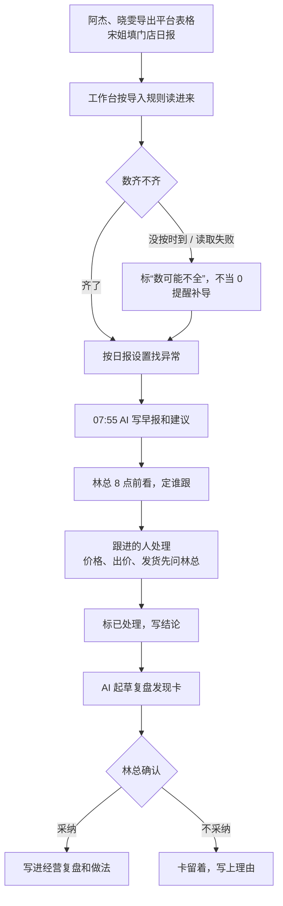
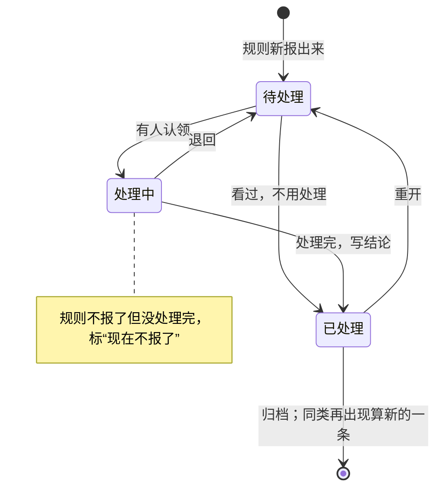

# 模块需求文档：多平台经营

> 一句话：给林总和运营阿杰、晓雯、门店宋姐用。抖店、天猫、小红书店、视频号小店、门店五个渠道的数放在一处，早上 8 点前看清昨天卖得怎么样、哪里不对劲、数齐不齐、谁去处理；处理完的事复盘回知识库。
> 状态：课上范例（按示例老板 ABC茶社 写，人和事全部虚构；真实老板用时改成“草稿”，确认后写“已确认（日期）”）｜版本：v1｜对焦记录：示例老板知识库 `99-原始材料/采访记录/2026-10-20-建库采访.md`

> 示例数据，人名、数字都是虚构的，只用示例知识库和工作台示例数据里有的。演示日是 2026-10-27，数据截至 10/26。

## 1. 为什么要做

结论：林总每天早上要一个平台一个平台登后台看数，没有对比；出了问题没人盯到底，处理完也没留下经验。

- 现在怎么做：林总说“平台后台每天早上一个一个登进去看”（第 1 题），“烦”（第 4 题）。门店的数在宋姐每晚填的飞书多维表格里。花多久：待确认。
- 卡在哪：
  1. 数是散的、没对比：要自己去比昨天、比上周。
  2. 不对劲发现得晚、没人认领：退款多了、推广花多了、货快断了，没人第一时间说，也不知道谁在管。
  3. 数不齐时容易看错：某个平台的表没导，或者平台改了表头，容易当成“昨天卖了 0”。
- 做完以后：打开“经营汇总”，10 秒内说出昨天全店卖了多少、比上周同一天多还是少、哪几件事要处理、每件谁在跟；哪个渠道的数没到，页面顶上写明，不算成 0。

## 2. 谁在什么时候用

| 场景 | 谁 | 什么时候 | 想知道或想做什么 | 现在要花多久 |
|---|---|---|---|---|
| 看昨天 | 林总 | 每天 8 点前 | 全店和各渠道昨天的成交，比前一天、比上周同一天；要处理哪几件事 | 一个个登后台，具体待确认 |
| 导数 | 阿杰（抖店、视频号小店）、晓雯（天猫、小红书店） | 每天 07:15—07:40 | 把平台导出的 5 张表交给工作台 | 待确认 |
| 门店日报 | 宋姐 | 每晚 21:30 填表，22:00 进工作台 | 当天成交、单数、进店人数、会员单数 | — |
| 处理异常 | 渠道负责人；售后找小周、小陈；发货、库存找老何 | 收到提醒当天 | 看证据和原因，认领、写处理记录、转待办 | 现在靠林总口头转 |
| 写早报 | AI（Codex 定时任务） | 每天 07:55 | 把昨天的数、异常、原因、建议写成一份 | 现在没有早报 |
| 复盘 | 林总 + 负责人 | 异常处理完；节日、大促后 | 结论和下次怎么做，记回知识库 | 没有固定做法（国庆复盘 AI 写了，林总还没看） |

## 3. 业务流程

结论：每天一轮——导数 → 看齐不齐 → 规则找异常 → AI 写早报 → 林总看、指人 → 处理完 → 复盘回知识库。

主流程：
1. **阿杰、晓雯**：07:15—07:40 从各平台后台导出 5 张表（店铺日报、商品、流量来源、售后、推广），放进工作台的导入文件夹，或拖进“导入”页。**宋姐**前一晚 21:30 填门店日报。
2. **工作台自动**：按存好的导入规则把表读进来（第一版由 Codex 定时任务到点点“立即同步”），每次记一条导入记录；新的表第一次进来，先由 AI 对字段、负责人或林总确认，存成规则。
3. **工作台自动**：判断每个渠道的数到没到（见第 4 节“数据新鲜度”）；没到的标出来，不当 0。
4. **工作台自动**：按日报设置的标准找异常（退款、推广、库存、成交四类），从数据里对出可能的原因。
5. **AI**：07:55 读工作台的数和异常，写当天早报，给每条异常写建议，写回工作台。
6. **林总**：8 点前看今日页或经营汇总，点开异常看证据；确认“谁跟”（默认是渠道负责人）。
7. **跟进的人**：改成“处理中”，写处理记录，要做的事转成待办。涉及价格、出价、发货方式、补偿的，先问林总。
8. **跟进的人或林总**：处理完点“已处理”，写一句结论。
9. **AI**：起草复盘；要改做法的，写成一张“发现卡”追加到知识库 `90-持续生长/待确认的发现.md`。**林总**点头后，由知识库那个 Skill 写进 `10-渠道与经营/经营复盘/` 和 `05-方法与判断/`。

例外和分支：
- **某渠道的表没按时到**（约定时间过 30 分钟）：标“没按时更新”，汇总页写“数可能不全”；这个渠道不算成 0，也不报“成交下降”。
- **平台改了表头、缺了必需的列**：导入停下，标“读取失败”，说清缺哪列；AI 给新对照，负责人确认后按新规则重导。不猜、不补 0。例：天猫生意参谋 10/20 改版，名字没变的列按旧规则对上，改了名的 4 列标“拿不准”，晓雯点头后存成新规则。
- **同一天同一渠道导了两次**：按“日期 + 渠道”覆盖，不累加；导错了能整批撤销。
- **导进来的数和平常差 3 倍以上**（比近 30 天的中位数）：预览里标出来请人核对，不拦。
- **节假日**：节后和国庆那周比会报“成交下降”。例：10/8 阿杰、晓雯、宋姐都写了“节后回落”，标已处理。
- **还没处理完、规则不报了**（数据恢复，或阈值改松）：留在列表里，标“现在不报了”，等人收尾。
- **已处理的异常过几天又出现**：算新的一条，重新提醒。
- **07:55 还有渠道没到**：早报照写，开头写明缺哪个渠道；补齐后要不要重写一份，待确认（同一天重写会替换旧的）。

## 4. 关键对象和状态

### 业务里有哪些“东西”

| 东西 | 是什么 | 要记哪些信息 | 从哪来 |
|---|---|---|---|
| 渠道 | 一个卖货的地方 | 名称、线上还是门店、负责人、从哪个仓发 | 知识库 `10-渠道与经营/README.md` 的索引 |
| 每天的数 | 一个渠道一天一行 | 成交额、订单、访客、退款金额和单数、推广花费、推广成交额、新客、老客 | 平台店铺日报、门店日报 |
| 明细 | 拆开看的数 | 流量来源、商品销售、退款原因（带发货批次）、推广计划（花费、点击、成交、出价）、库存（现有、在途）、小红书店逐单售后、抖店云仓入仓预约 | 同一次导出的另几张表、仓库 |
| 运营记录 | 谁哪天做了什么 | 时间、渠道、谁、类型（出价、价格、发货、活动、库存、上新、其他）、做了什么 | 负责人记，找原因时对着看 |
| 数据源 | 数从哪来 | 方式、谁导、约定时间、最近一次成功、数据截至哪天、状态 | 知识库 `01-AI协作/工具与账号.md` |
| 导入记录 | 每次导入 | 文件、行数、日期范围、结果、失败原因 | 工作台自动记 |
| 异常 | 规则找出的不对劲 | 类型、渠道、从哪天起、证据、可能的原因、建议（谁几点写）、状态、谁跟、处理记录、处理结论、复盘去向 | 工作台每天算 |
| 早报 | 一天一份 | 写的是哪天的数、谁几点写的、四段正文 | AI 写回 |
| 日报设置 | 只有一份 | 看哪些指标、跟谁比、四条异常标准、写多长、几点写 | 林总定 |

指标口径以知识库 `10-渠道与经营/数据口径.md` 为准：成交额是当天付款金额、不扣退款；退款率 = 退款金额 ÷ 成交额；推广 ROI = 推广成交额 ÷ 推广花费；全店转化率只算 4 个线上平台，门店单独看。比率一律先加总再相除。企业茶礼和渠道供货不进每天的数。

### 状态节点

**数据新鲜度**（每个数据源一个状态）：

| 状态 | 什么意思 | 怎么进来（谁、做了什么） | 下一步能去哪 | 进来时自动发生什么 |
|---|---|---|---|---|
| 正常 | 按时到了 | 导入成功 | 没按时更新、读取失败、停用 | 汇总页顶上这个渠道亮绿点，写几点进来的 |
| 没按时更新 | 约定时间过了 30 分钟还没有新数 | 工作台自动判断 | 正常（补导成功） | 汇总页写“数可能不全”；弹提醒，写明谁负责导，每个来源每天最多一次 |
| 读取失败 | 导了但没进去：表头对不上、缺必需的列、文件格式不对 | 导入时自动记 | 正常（确认新对照后重导） | 数停在上一天，图上留缺口；弹提醒，写明缺哪列 |
| 没数据 | 这个渠道一行数都没有 | 新渠道还没导过，或示例数据清掉了 | 正常 | 页面告诉你去导一份 |
| 停用 | 不再读这个来源 | 林总或负责人停用 | 正常（重新启用） | 不再提醒 |

经营页按渠道再归成两种：**到了**、**没按时到**（来源没按时更新或读取失败，或数据只到前天）。

**异常**（每条异常一个状态）：

| 状态 | 什么意思 | 怎么进来（谁、做了什么） | 下一步能去哪 | 进来时自动发生什么 |
|---|---|---|---|---|
| 待处理 | 规则报出来了，还没人动 | 工作台每天按规则算出来 | 处理中、已处理 | 记下第一次发现的日子；“谁跟”默认填渠道负责人；提醒一次；今日页、导航角标计数 |
| 处理中 | 有人在跟 | 跟进的人或林总在异常抽屉里点 | 已处理、退回待处理 | 记谁几点改的；可以写处理记录、转待办 |
| 已处理 | 处理完了，或看过不用处理 | 跟进的人或林总点，写一句结论 | 重开回待处理 | 不再出现在今日页和提醒里；AI 起草复盘 |
| 现在不报了（标记） | 没处理完，但按现在的标准规则不报了 | 数据恢复，或标准改松 | 已处理 | 留在列表里，标出来提醒收尾 |

### 改状态的规矩
- 异常只有三种状态；网页和命令行都能改，每次改都记进“最近改动”（谁、几点、改了什么）。
- 改成“已处理”要写一句结论；节后回落这类“不用处理”也要写一句为什么。
- AI 可以写建议、写处理记录草稿，不替人点“已处理”（待林总确认）。
- 已处理的不删，按时间倒序留在“已处理”页签里。

## 5. 页面和交互

放在导航哪里：分区“经营”。第一项“经营汇总”；分组“渠道”：抖店、天猫、小红书店、视频号小店、门店；分组“数据”：数据源、导入（子页面：导入文件、导入记录、导入规则）。手机底栏的“经营”进汇总页。

| 页面 | 第一屏看到什么 | 能做什么 | 详情怎么打开 |
|---|---|---|---|
| 经营汇总 | 顶上一行数据新鲜度；首屏四样：昨天成交大数字（比前一天、比上周同一天）、近 15 天走势、今天最要紧的事、最新一份早报 | 切近 7 / 14 / 30 天；8 张指标卡、各渠道每天成交、占比、分渠道对比表、异常列表（还没办完 / 已处理 / 全部）、早报历史；开“日报设置” | 点数字看来源，点异常、早报开右侧抽屉 |
| 渠道页（5 个） | 这个渠道的数从哪来、几点进来；指标卡 | 成交和订单走势（各一张）、人从哪来、商品前 5、退款原因、推广花费和 ROI（画一条“2”的参考线）、库存、运营记录、导入记录；渠道特有：天猫推广计划、小红书店售后明细、抖店云仓和入仓预约、门店一周里哪几天人多和会员占比 | 同上 |
| 异常抽屉 | 一段话：哪个渠道、从哪天起、多大 | 改状态、定谁跟、写处理记录和结论、转待办；看证据图、可能的原因、建议、同期运营记录；生成复盘 | 地址栏带异常编号，刷新不丢、能分享 |
| 早报抽屉 | 谁几点写的、写的是哪天 | 看四段全文，翻前几天 | 同上 |
| 日报设置抽屉 | 现在的标准，一句话 | 改看哪些指标、跟谁比、四条标准、写多长、几点写 | 汇总页右上角 |
| 数字来源抽屉 | 公式和口径说明 | 看每天每个渠道的原始数、哪几次导入带进来的 | 点任何指标卡 |
| 数据源 | 每个来源一行：方式、谁导、约定时间、最近一次、数据截至、状态 | 立即同步；看运行记录；确认新对照后重导 | 右侧抽屉 |
| 导入 | 四步：拖文件 → AI 认表和对字段 → 预览 → 导入完成 | 改“拿不准”的对照；在导入记录里整批撤销；停用或启用导入规则 | 页内步骤 |

关键交互过程（例：小红书店退款）：
1. 林总 8 点前收到“看汇总”提醒，打开今日页“各平台昨天卖得怎么样”，小红书店一行标红“退款率偏高”，点“经营汇总”。
2. “今天最要紧的事”第一条：小红书店退款率 10/24 起从约 3% 升到约 11%。点开异常抽屉。
3. 证据图是每天的退款率和异常线；原因写“运输破损”最多，集中在 10/23 发货的玻璃公道杯；运营记录里有老何 10/22 记的“气泡柱用完了……玻璃公道杯先用普通纸箱发”。
4. “谁跟”已经默认是晓雯；林总点“起草一条给晓雯的话”，AI 按“谁、做什么、哪天前”写好，林总看过自己在飞书发。
5. 晓雯改“处理中”，写处理记录（碎了的单退款或补发，同批没反馈的买家去问一遍），转成待办。写进这条异常的处理状态，记“最近改动”。
6. 晓雯处理完点“已处理”，写结论。AI 起草发现卡（例：玻璃件包材用完先停发），林总在“待确认的发现”里点头，再写进经营复盘。

今日页放什么：“各平台昨天卖得怎么样”（合计成交、订单、退款率、推广 ROI，每个渠道一行，异常标红）；“数据异常提醒”（经营异常和没跟上的数据源，每条附线索）；早报第一句和“看全文”。

## 6. AI 帮什么

| AI 做什么 | 什么时候 | 读哪些资料 | 结果写到哪 | 要老板确认吗 |
|---|---|---|---|---|
| 认表、对字段 | 新的表第一次进来；表头变了 | 表头和前 20 行、常见叫法、知识库《数据口径》 | 导入页的对照建议，拿不准的标出来 | 要：负责人或林总确认后才导、才存规则 |
| 写早报 | 每天 07:55 | 工作台的数、异常和证据；《数据口径》、各渠道档案的“平常水平” | 工作台早报，一天一份，四段：昨天怎么样 / 哪里不对劲 / 可能的原因 / 建议 | 不用确认就显示，标“AI 写的、几点写”；建议不自动执行 |
| 给异常写建议 | 写早报时一起 | 同上，加《售后与补偿》《推广出价与上新》 | 异常抽屉“建议”，写明谁几点写 | 涉及价格、出价、发货方式、补偿的，林总拍板 |
| 起草给负责人的话 | 定了“谁跟”以后 | 异常、建议、团队分工 | 抽屉里的草稿 | 要：林总看过自己发 |
| 起草复盘 | 异常标“已处理”后；节日、大促后 | 证据、处理记录、运营记录 | 发现卡追加到 `90-持续生长/待确认的发现.md` 末尾 | 要：林总采纳后才写进经营复盘和做法 |

“可能的原因”不是 AI 猜的：工作台从退款原因、运营记录、推广计划、流量、库存、入仓预约里对出来，每条写清依据来自哪张表。AI 在早报里补充的推断要标“推测”。

## 7. 提醒

| 什么时候 | 提醒什么 | 点开去哪 |
|---|---|---|
| 新出现一条经营异常 | “新出现 N 处经营异常”；连着几天都在只提醒一次，消失两天以上又出现再提醒 | 渠道页，直接打开这条异常 |
| 数据源过了约定时间 30 分钟没新数，或导入失败 | 哪个来源没跟上；每个来源每天最多一次 | 数据源页那一行 |
| 每天林总定的时间（林总说 8 点前要看完；具体几点待确认） | 今天的汇总好了 | 今日页 |
| 异常“处理中”超过几天没动（天数待确认） | 哪条异常、谁在跟 | 异常抽屉 |

提醒只在工作台所在的电脑上弹；推到团队成员手机上，以后再说。

## 8. 数据从哪来、存在哪

| 数据 | 从哪来 | 多久更新 | 谁写进来 | 和知识库的关系 |
|---|---|---|---|---|
| 各渠道每天的数 | 抖店后台、生意参谋、千帆后台、微信小店后台导出；门店飞书多维表格「门店日报」 | 每天：抖店 07:20、天猫 07:30、小红书店 07:35、视频号小店 07:40；门店前一晚 22:00 | 阿杰、晓雯导出，宋姐填表，工作台按规则读 | 口径以《数据口径》为准；每天的数不进知识库 |
| 商品、流量来源、退款原因、推广计划 | 同一次导出的另几张表 | 每天 | 同上 | 同上 |
| 库存、云仓入仓预约 | 仓库表、抖店后台 | 每天 | 老何、阿杰 | 同上 |
| 运营记录 | 负责人记 | 发生时 | 阿杰、晓雯、老何、宋姐 | 不进知识库 |
| 数据源清单 | 知识库《工具与账号》 | 有变化时 | 林总确认 | 以知识库为准 |
| 导入规则 | 第一次对字段后存 | 表头变了再改 | 负责人或林总确认 | 存在工作台的导入规则文件夹 |
| 日报设置 | 林总 | 想改就改 | 林总 | — |
| 早报、建议 | AI | 每天 07:55 | Codex 定时任务 | 不进知识库；要沉淀的走复盘 |
| 复盘 | AI 起草 | 事后 | 林总确认 | 发现卡进 `90-持续生长/待确认的发现.md`；采纳后进 `10-渠道与经营/经营复盘/`、`05-方法与判断/` |

## 9. 规矩和边界

- 一定要老板确认的：改价格、改推广出价（运营可以自己调，大改先跟林总说）、改发货方式、补偿；第一次存导入规则和“拿不准”的字段；复盘结论和要改的做法；改日报设置。
- 不能做的：不登录平台后台，不改价格、出价、不上下架；不替林总给客户或团队发消息，只起草；缺的数不当 0、不猜；知识库已确认的内容不改，工作台只在“待确认的发现”末尾追加。
- 隐私：每天的数和订单明细只在工作台；账号、密码、验证码不进任何文件和截图；售后明细照导出表存，截图、演示和只读手机版里打码买家手机号、地址；企业茶礼的价格不进经营页；待上线的新品在商品表里标“待上线”，不出现在任何对外内容里。

## 10. 第一版做什么

- 第一版一定要有：经营汇总和 5 个渠道页；四类异常和三种状态、谁跟、处理记录、转待办；07:55 的 AI 早报；日报设置；数据新鲜度；导入店铺日报（对字段、预览、撤销）；数字来源。再加几样新的：谁跟默认填渠道负责人、人选来自团队分工；已处理的再出现算新的一条；已处理要写结论；复盘发现卡；今日页放早报第一句；商品、退款原因、推广计划、库存这几张明细表能导入；运营记录能记；渠道清单能用命令建。
- 以后再说：流量来源、小红书店逐单售后、云仓入仓预约的导入；直接读 Excel 文件；提醒推到团队成员手机；按约定时间自动去导入文件夹取表（先由 Codex 定时任务点“立即同步”）。
- 不做：接平台接口、网页自动化和爬虫（交给专业的数据团队）；替人改平台后台；企业茶礼、渠道供货并进每天的数。

## 11. 怎么算好（验收）

- [ ] 打开经营汇总，10 秒内说出昨天全店成交、比上周同一天多还是少、要处理哪几件事、各是谁在跟。
- [ ] 点任何一个数，能看到是哪几天、哪几个渠道、哪次导入带进来的。
- [ ] 每条异常都写清哪个渠道、从哪天起、证据是哪几天的数；原因带依据，猜的标“推测”；建议写明谁几点写的。
- [ ] 让一个渠道停一天不导：汇总页写“数可能不全”，这个渠道不算成 0，也不报“成交下降”。
- [ ] 拖一份删掉“推广花费”列的表：导入停下说缺哪列；同一份表导两次，数不翻倍；导错的能整批撤销。
- [ ] 日报设置里把退款率下限从 6% 调到 20%：小红书店那条退款异常标“现在不报了”；调回去又正常报。
- [ ] 07:55 以后能看到当天早报，四段，第一句说清全店成交和要处理几件事；同一天重写只留一份。
- [ ] 天猫推广那条异常默认由晓雯跟；改成已处理后今日页不再提醒；过几天同类再出现，算新的一条、重新提醒。
- [ ] 一条已处理的异常能生成发现卡，追加在“待确认的发现”末尾，格式和库里已有的一样；林总没点头前，经营复盘文件夹不多文件。
- [ ] 手机宽度能看；`npm run build`、`npm run doctor` 通过

## 12. 给开发的提示

- 参考实现：模板的经营模块已经做了大半，照用为主。
  - **照用**：汇总页、渠道页、4 种抽屉（`src/features/biz/`，`server/modules/biz/board.ts`、`channel.ts`、`trace.ts`）；异常规则 `service.ts` 的 `anomalies()`，时间段 `period.ts`（近 3 天对比之前两周：最近一天往前 20 天到往前 6 天），标准 `config.ts` 的 `DEFAULT_CONFIG`（`refund_mult 2`、`refund_min 6`、`roi_min 2`、`roi_drop 50`、`stock_days 3`、`gmv_drop 30`、`write_at '07:55'`；`write_at` 只是记下来，真正几点跑要在 Codex 定时任务里设）；近 3 天退款至少 300 元、推广花费至少 500 元这两道门槛写死在 `service.ts`，不在日报设置里；退款、推广、库存是“高”，成交是“中”；库存只在最新一天报，有在途的不报。异常状态 `anomaly.ts`（`ANOMALY_STATUS`、`quiet`、转待办 `todoOf()`）；原因 `evidence.ts`、`ads.ts`；早报 `reports.ts`（一天一份、同日替换，`method` 为定时任务 / 命令行 / 手写，网页只读）；新鲜度 `freshness.ts` 加 `server/modules/data/service.ts` 的 `displayOf()`（`GRACE_MIN = 30`）；导入 `server/modules/data/`；提醒 `server/reminders/rules.ts`。
  - **要改**：导入只写 `channel_daily`（`import_rules.target` 只有 `channel_daily`、`xhs_note_stats`），要加 `channel_products`、`channel_refunds`、`channel_ads`、`inventory`；导入成功后 `data_sources.next_run_at` 不会往后推（只有种子写过），要按约定时间推到下一次；`AnomalySheet.tsx` 的 `useTeam()` 从运营记录取人，改成团队名单，默认 `channels.owner`；`anomaly.ts` 的 `todoOf()` 写死了“晓雯”，改读负责人；`biz-anomaly-set` 现在允许 Codex 改状态，按第 4 节规矩收紧（待确认）；今日页（`src/features/today/`）还没有早报；导入只认逗号分隔的表格（`importer.ts` 拒收 .xlsx），读 Excel 放以后。
  - **还没有，要新做**：派给某人时起草给他的话；改“已处理”必须写结论；已处理后再出现算新的一条（种子用了 `<规则ID>@<第一次发现日>` 的历史写法，代码不会生成）；复盘发现卡写进 `90-持续生长/待确认的发现.md`（照客户模块 `server/modules/crm/materials.ts` 的 `FINDINGS_FILE` 写法）；“处理中”太久没动的提醒；按约定时间自动同步（`sync.ts` 只有“立即同步”，服务端没有定时取表）；渠道、商品、仓库只有种子 `seed/biz.ts` 能写；运营记录 `biz_ops_log` 只有种子写，推广异常里“出价从几调到几”靠它。
- 模块开关 id：`biz`。打开 `biz` 时自动带上 `data`（数据源与导入），见 `references/搭建步骤.md` 第 4 步。
- 渠道现在是 5 个：`douyin` 抖店、`tmall` 天猫、`xhs` 小红书店、`wechat` 视频号小店、`store` 门店。写死在这些地方：
  - 服务端：`server/modules/biz/freshness.ts` 的 `SOURCE_OF`；`server/modules/data/fields.ts` 的 `CHANNELS`（名称、数据源、别名）和 `PROFILES`（各平台表头特征）；`server/modules/data/service.ts` 的 `SHORT`；门店口径按 `'store'` 判断的有 `metrics.ts`、`board.ts`、`trace.ts`、`channel.ts`、`extras.ts`、`data/recognize.ts`；渠道特有面板在 `channel.ts`（`xhs` 售后、`wh_dy` 云仓）和 `extras.ts`；节假日在 `period.ts` 的 `HOLIDAYS`；种子 `seed/biz.ts`、`seed/data.ts`。
  - 网页：`src/app/nav.ts` 的 5 个 `ch-*` 菜单项；`src/features/biz/fmt.ts` 的 `CHANNEL_ORDER`（图表颜色顺序，只有 `--chart-1` 到 `--chart-5`）和 `PLATFORM_TOOL`；`ChannelPage.tsx` 的 `CHANNELS`；`fresh.tsx` 的 `SHORT`；`BizSummaryPage.tsx` 页头说明；`channel/Mix.tsx`、`Trends.tsx`、`Store.tsx`；`src/features/data/labels.ts`；测试 `scripts/nav.test.mjs`。
  - 别的老板渠道不一样时：① 用新命令建渠道（编号、名称、线上 / 门店、负责人、仓库）；② `fields.ts` 加别名和表头特征，`freshness.ts` 和数据源对上；③ `nav.ts` 加减 `ch-<编号>` 菜单项；④ `fmt.ts` 改颜色顺序，超过 5 个渠道要加色；⑤ 门店口径改成按 `channels.kind = '门店'` 判断，不认 `'store'`；⑥ 渠道特有面板按需留或删；⑦ 跑 `npm test`、`npm run build`、`npm run doctor`。建议顺手把渠道清单收成一处，网页从接口读。
- 建议的表和字段：现有 `channels`、`channel_daily`（视图 `channel_daily_v`）、`channel_traffic`、`channel_products`、`channel_refunds`、`channel_ads`、`inventory`、`biz_ops_log`、`biz_reports`、`biz_report_config`、`biz_anomalies`、`biz_aftersales`、`biz_inbound`；数据侧 `data_sources`、`import_runs`、`import_rules`、`data_batches`。新增迁移 `012_biz_02_异常派发与复盘.sql`：`biz_anomalies` 加 `resolution`（处理结论）、`assigned_at`、`assigned_by`、`review_status`（没写 / 已提交 / 已采纳 / 不采纳）、`review_ref`（发现卡标题）。团队名单从 `03-生意/团队与伙伴/团队分工.md` 读，不另建表。
- 要加的命令行命令：`biz-channel-add`（建渠道）、`biz-ops-add`（记运营记录）、`biz-anomaly-review <异常ID>`（起草发现卡，加 `--yes` 才追加）、`biz-anomaly-set` 改“已处理”时必须写结论（新参数 `--resolution`）；`import` 支持明细表。已有：`biz-report`、`biz-report-set`、`biz-anomalies`、`biz-anomaly-set`、`biz-config`、`import-check`、`import`、`import-undo`、`import-sync`。
- 遵守：工作台程序文件夹里的 `规范/README.md`。

## 附：对焦时的关键原话

出处：示例老板知识库 `99-原始材料/采访记录/2026-10-20-建库采访.md`。

- “早上八点前要看完昨天各个平台卖得怎么样。”（第 1 题）
- “还有就是每天早上一个平台一个平台登后台看数据，烦。”（第 4 题）
- “数字要有对比，比昨天怎么样，比上周呢，光一个数没意思。”（第 10 题）
- “最怕答应客户的事忘了，到日子才想起来；还有货快没了没人跟我说。”（第 10 题）
- “企业茶礼的钱别跟每天的数混一起看。”（第 2 题追问）
- “推广出价阿杰、晓雯自己调，大改之前跟我说一声。”（第 5 题）
