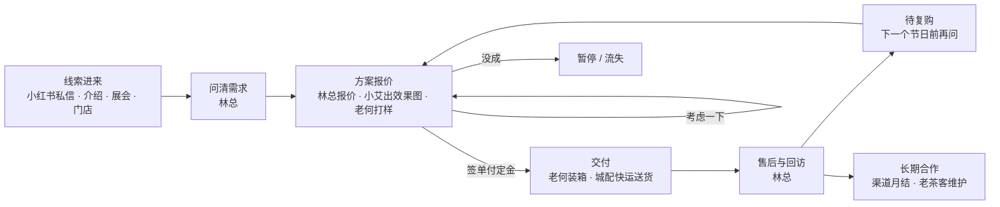
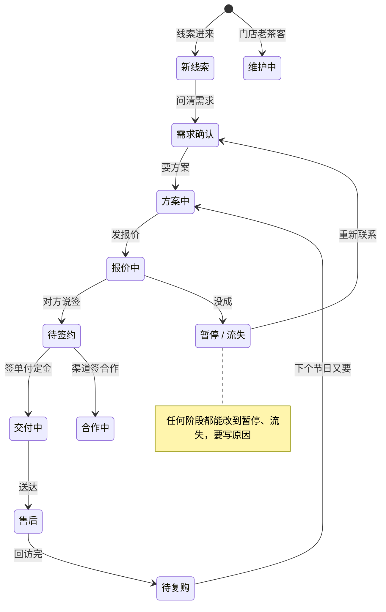

# 模块需求文档：客户跟进

> 一句话：给林总和团队用，把企业茶礼、渠道供货的大客户从“线索进来”一路管到“复购和长期合作”；打开就知道哪家聊到哪了、卡在谁那里、今天该谁动。
> 状态：课上范例（按示例老板 ABC茶社 写，人和事全部虚构；真实老板用时改成“草稿”，确认后写“已确认（日期）”）｜版本：v1｜对焦记录：示例，根据 `99-原始材料/采访记录/2026-10-20-建库采访.md` 整理（ABC茶社，人和事全部虚构）
> 读法：标“（新）”的是模板参考实现里还没有、要新做的；没标的模板里已经有。第 12 节逐项列出。

## 1. 为什么要做

结论：客户全在林总脑子和微信里，人一多就会漏；最怕答应的事忘了、老客户跟丢、不知道活卡在谁手上。

- 现在怎么做：林总原话“一半在企业大客户上，这个我自己来跟，报价、交期我自己定”；“客户基本都在微信上……报价单、对账用 Excel”。知识库里 10 位大客户有档案，另外 18 位普通客户和线索不建档。
- 卡在哪：
  1. 答应的事靠记性：“最怕答应客户的事忘了，到日子才想起来。”
  2. 看不清每家卡在哪、卡在谁：效果图在小艾、打样装箱在老何、有的在等对方回、有的是自己拖了（青砚约好 10/20 联系，过了还没打）。
  3. 复购靠节前临时想起：澜拓两单十万出头，林总说“老客户，别跟丢”。
- 做完以后（林总自己能检验）：
  - 打开任何一位大客户，10 秒内说出“他在意什么、上次聊到哪、我答应了什么”。
  - 早上打开今日页，看到今天该跟哪几家、为什么。
  - 问 AI 一句“哪些客户卡着”，它按人列出来：该我动的、该小艾或老何动的、在等对方的。（新）

## 2. 谁在什么时候用

| 场景 | 谁 | 什么时候 | 想知道或想做什么 | 现在要花多久 |
|---|---|---|---|---|
| 看今天跟谁 | 林总 | 每天早上看完各平台的数以后 | 今天该跟哪几家企业客户、为什么 | 待确认（靠翻微信） |
| 聊完记一笔 | 林总 | 每次打电话、回微信、见面后 | 聊了什么、答应了什么、下次哪天联系 | 待确认 |
| 整理聊天和纪要 | 林总 + AI | 收件箱里有新材料时 | AI 先提取，林总看过再写进去 | 待确认 |
| 看团队手上的客户活 | 林总、小艾、老何 | 每周一 9:30 门店二楼周会 | 哪几家卡在谁那里、谁哪天前做什么（新） | 待确认 |
| 接活干活 | 小艾、老何 | 林总派活时 | 哪家、做什么（效果图 / 打样 / 装箱 / 送货）、哪天前（新） | 待确认 |
| 节前排复购 | 林总 | 春节预售前（11/15 起老客户先通知） | 去年谁买过什么、先问谁 | 待确认 |
| 关怀问候 | 林总；会员群宋姐发 | 生日、立冬、太久没联系 | 送什么、怎么说 | 待确认 |
| 月底对账 | 林总 | 每月月底 | 南屿这类渠道客户的月结货款收了没有 | 待确认 |

## 3. 业务流程

结论：一单企业茶礼走“线索 → 问清需求 → 方案报价 → 签单 → 交付 → 售后回访 → 待复购”，复购又回到方案报价；渠道客户和门店老茶客进入长期合作。

主流程：
1. 线索进来：来源以知识库为准——小红书私信、老客户和朋友介绍、展会和茶博会、来门店喝茶的人。林总新建客户，记来源和细节（谁介绍的、哪场展会、哪篇笔记），阶段“新线索”，约下次跟进。
2. 问清需求：林总问清份数、用途（送员工还是送客户）、预算、哪天要到、谁拍板。
3. 方案报价：林总用三档礼盒报价（经典双罐 180、岩茶木盒 260、花草茶礼 160），三档以外的组合按单报；报价单 AI 可以起草，林总改过再发。
4. 打样：小艾出效果图，老何做实物样。最花时间，一家要来回好几轮；报价时就说清改几轮、哪天定稿。
5. 签单付定金：林总。新客户先付三成定金，老客户可以走对方的付款流程。工作台记订单、定金和尾款。
6. 装箱送货：老何装箱（每天最多 30 份左右，签单后 15—20 天交），同城由城配快运送，对方签收。
7. 售后：有压坏、错发、延期，按《售后与补偿》：先认、林总先打电话道歉，补的货林总自己送。
8. 回访：送完几天内林总回访，问反馈，顺便问下一个节日（澜拓 9/18 送完，9/22 回访）。
9. 复购：下一个节日前带新方案去问（春节这波 11/15 开始，老客户先通知），回到第 3 步。
10. 长期合作：渠道客户按月供货、月底对账、月结（南屿）；门店老茶客由林总打电话、宋姐管日常。

每一步结束：林总记一笔往来（或让 AI 从聊天里提取，确认后写）；答应的事单独记；约好下次跟进的日子。（新）每件活写清谁做、哪天前。

例外和分支：
- 对方说“考虑一下”“可能还要”：不算往前走，阶段不动，只约下次跟进（澜拓“11 月再聊”）。
- 报了价没回音：算“在等对方”，到日子林总打电话问（康屿 10/19 发报价单没回，10/29 打电话）。
- 交期短于 15 天又超过 150 份：按判断规则 1，只接做得好的那部分，剩下建议换现货款或分批送。
- 新客户拿别家价格来比：按判断规则 2（待确认），单价不降，改送升级包装或印 logo；答应的价格低于标价，标黄等林总定。
- 老客户介绍新客户（澜拓介绍锦川、许国平带来栖木）：来源写清谁介绍的；要不要给介绍人回礼，待确认。
- 第三方线索（买来的或平台给的客资）：知识库里还没有这类来源，要不要做、怎么导入，待确认。
- 暂停、流失：写原因，之后不再出现在“该联系了”和跟进提醒里。

## 4. 关键对象和状态

### 业务里有哪些“东西”

| 东西 | 是什么 | 要记哪些信息 | 从哪来 |
|---|---|---|---|
| 客户 | 一家企业、一家渠道店或一位老茶客 | 称呼、补充说明、客户还是伙伴、分组（企业茶礼 / 门店老茶客 / 渠道合作 / 零售）、是不是大客户、联系人和职务、谁拍板、人数、来源和细节、哪天认识、阶段、上次联系、下次跟进、下一步、平常怎么称呼；负责人（新）、在等谁（新） | 10 位大客户从知识库 `04-客户/` 导入；其余在工作台新建 |
| 往来记录 | 每一次沟通 | 日期、渠道（微信 / 电话 / 面谈 / 到店 / 邮件 / 其他）、和谁、说了什么、对方的状态、怎么定（谁拍板、哪天定、在跟谁比）、顾虑、下一步、原件在哪 | 记一笔、新材料提取 |
| 答应的事 | 我们亲口答应对方的 | 谁答应、答应谁、答应什么、哪天前、状态（待兑现 / 已兑现 / 取消）、和规则对不上的地方、林总怎么定 | 新材料提取、手动加 |
| 商机 | 一笔在谈的单 | 名称、阶段（需求确认 / 方案中 / 报价中 / 待签约 / 已签约 / 没成）、金额（万元）、预计哪天定、是不是按去年估的 | 工作台 |
| 订单 | 买过的东西 | 日期、渠道（企业茶礼 / 门店 / 线上 / 渠道月结）、场合、商品、份数、单价、金额（元）、状态 | 工作台 |
| 应收款 | 定金、尾款、月结货款 | 金额、哪天到期、收了多少 | 工作台 |
| 喜好与顾虑 | 一条一句话 | 类别（口味 / 包装 / 送礼对象 / 禁忌 / 顾虑 / 习惯）、从哪听来的 | 知识库档案、新材料提取 |
| 重要日子 | 生日、纪念日、节日、公司节点 | 日期（每年重复的只记月日）、谁的 | 知识库档案、新材料提取 |
| 关怀 | 一次问候或送礼 | 场合、日子、送什么、怎么说、状态（建议 / 已安排 / 已送出 / 不做）、谁写的 | AI 定时写、现场写、模板拼、林总写 |
| 跟进待办 | 一件要做的事 | 标题、截止、状态（待办 / 进行中 / 等别人 / 完成 / 取消）、优先级、关联客户、谁做、从哪来 | 填下次跟进自动建、手动、提取 |
| 团队成员（新） | 林总、小艾、老何、宋姐…… | 名字、管什么 | `03-生意/团队与伙伴/团队分工.md` |

客户等级（工作台自动算，林总没定过，待确认）：近 12 个月买了 3 万以上，或报价中、待签约的单 2 万以上算 A；5000 元以上或 0.5 万以上算 B；其余 C。

### 状态节点

结论：客户阶段只用这 12 个；看板把它们归成 5 列（新线索、方案报价、交付售后、待复购、长期合作），暂停和流失单独收起。

| 状态 | 什么意思 | 怎么进来（谁、做了什么） | 下一步能去哪 | 进来时自动发生什么 |
|---|---|---|---|---|
| 新线索 | 刚认识，还不知道要什么 | 林总新建客户（康屿：茶博会留名片） | 需求确认 | 新建时就是这一阶段 |
| 需求确认 | 在问份数、用途、预算、交期 | 林总问过需求后改 | 方案中 | 留痕 |
| 方案中 | 在出方案、出效果图 | 林总改（栖木：发了两个组合思路） | 报价中 | 留痕；（新）按团队分工建“效果图”待办给小艾 |
| 报价中 | 报了价，对方在看、在比 | 林总发报价单后改（衡言） | 待签约 | 留痕 |
| 待签约 | 对方说要签，等签单付定金 | 林总改 | 交付中、合作中 | 留痕 |
| 交付中 | 签了单，在装箱送货 | 林总签单收定金后改 | 售后 | 留痕；（新）建“装箱”“送货”待办给老何 |
| 售后 | 送到了，在处理反馈或问题 | 送达后林总改（锦川：6 盒压坏补发中） | 待复购 | 留痕；（新）送达几天内提醒林总回访（几天待确认） |
| 待复购 | 买过，等下一个节日 | 回访完林总改（澜拓、青砚） | 方案中、报价中 | 留痕；（新）建议下次跟进定在下个节日预售前 |
| 合作中 | 渠道长期供货，按月结 | 签合作后林总改（南屿） | 暂停、流失 | 留痕 |
| 维护中 | 门店老茶客，常来常买 | 林总或宋姐改（许国平、方雅琴） | 暂停、流失 | 留痕 |
| 暂停 | 这阵子不谈了 | 林总改，写原因（明石建设） | 回到任何一步 | 留痕；不再进“该联系了”、跟进提醒、久未联系 |
| 流失 | 不来往了 | 林总改，写原因（嘉禾地产） | 回到任何一步 | 同上 |

### 改状态的规矩
- 阶段只能是上面 12 个；改阶段一定写一句原因（至少两个字），留下新旧值、谁改的、什么时候。和原来一样的不让改。
- 阶段只在林总确认后改：AI 提取新材料从不改阶段；“考虑一下”“再看看”“可能还要”不算往前走。
- 看板上拖动卡片换阶段，松手后写原因；一列里有几个阶段的，再选具体哪个。卡片上不放改阶段的下拉。
- 顺序不卡死：哪个阶段都能改到别的阶段，靠原因留痕。
- 客户阶段和商机阶段分开记：一家可以同时有几笔单（澜拓：中秋已签约，春节按去年估了一笔）。按去年估的单灰字写“估”，不算进在谈金额。
- 改下次跟进只能选今天或以后；改答应的事（标兑现、取消、改日期、改内容）也要写原因，都留痕。
- （新）改负责人、改“在等谁”也留痕。

## 5. 页面和交互

放在导航哪里：分区“客户”，菜单“客户与跟进”（手机底栏叫“客户”，角标是该联系的人数）。子页面 6 个：客户列表、跟进看板、关怀与回访、新材料提取、跟进清单、应收款。不加新页面，“按人看”做成跟进清单里的页内切换。（新）

| 页面 | 第一屏看到什么 | 能做什么 | 详情怎么打开 |
|---|---|---|---|
| 客户列表 | 一排状态页签（全部 / 新线索 / 方案报价 / 交付售后 / 待复购 / 长期合作）；表格或卡片：等级、客户、联系人、阶段、累计消费、上次联系、下次跟进、提醒标签（久未联系、有新材料、生日临近、有冲突待定）、在谈金额 | 搜索、只看大客户、范围（在跟 / 暂停流失 / 伙伴）、排序（下次跟进、累计消费、多久没联系、今年成交）、新建客户 | 点名字开右侧抽屉，可再开整页 |
| 跟进看板 | 5 列，列头写人数和在谈金额；卡片：名字、等级、联系人、具体阶段、一个主数 | 拖动换阶段（写原因）；切到“按商机”看每笔单 | 点卡片开抽屉 |
| 客户详情 | 头部：联系人和拍板人、阶段、来源、累计消费、上次联系、下次跟进；4 个页签：概况 / 往来和答应 / 订单与消费 / 关怀 | 记一笔跟进、改阶段、改下次跟进；（新）改负责人、标“在等谁” | 抽屉、整页、给 AI 侧栏用的嵌入页三处同一份 |
| 跟进清单 | 三栏：该联系了（下次跟进在 2 天内或已过）、我在等别人、别人在等我（3 天内到期的客户待办） | 记一笔、约时间；（新）切到“按人看”：林总 / 小艾 / 老何 / 在等对方，各有哪几家、什么活、哪天前 | 点一行开客户或待办 |
| 关怀与回访 | 未来 30 天的生日、纪念日、立冬和太久没联系的人，每人一条建议（送什么、怎么说、谁写的）；右栏春节要提前问的老客户 | 复制草稿、标记已发、改一改；让 AI 写一版 | 点名字开客户 |
| 新材料提取 | 左边收件箱里的聊天和纪要（或粘贴），右边原件和提取结果 | 让 AI 提取、改一改、确认写入、撤销 | 地址栏记住选中的材料 |
| 应收款 | 定金、尾款、月结货款，按状态切（逾期 / 7 天内到期 / 部分收款……） | 登记回款 | 点一行开明细 |

客户卡片的四个关键数按情况换：买过的看“今年成交 / 上次下单 / 待回款 / 多久没联系”；在做的看“在做 / 收款 / 卡在哪”；还没成交的看“在谈 / 预计哪天定 / 卡在哪”。注意：现在的“卡在哪”写的是对方的顾虑（如“包装有点普通”），（新）要再加一行“该谁动”。

关键交互一：聊完记一笔
1. 林总在客户抽屉点“记一笔跟进”，填日期、渠道、说了什么、下一步、下次跟进。
2. 保存后：往来记录加一条；上次联系、下一步跟着改；原来约的日子到了又没填新日子的，清空下次跟进。
3. 那条“跟进某某”的自动待办算完成；填了新日子再建一条（优先级“重要”）。那天已有这家的待办或日程就不再建。

关键交互二：新材料提取
1. 林总在“新材料提取”选一份收件箱里的聊天或纪要（或粘贴，至少 20 个字）。
2. AI 提取（最多等 150 秒），等的时候工作台先按字面标出要核对的几句：价格份数、日子、“还没定”、来门店。
3. 结果分段：说了什么、我们答应了什么（谁、给谁、哪天前）、对方的状态、顾虑、怎么定、下一步、建议下次跟进；和判断规则对不上的标黄。
4. 林总改一改，勾上要不要改商机金额、要不要写回知识库客户档案，点“确认写入”。
5. 写进往来记录、答应的事、待办、喜好、重要日子、下次跟进；写回知识库前先给看改哪几处、先备份；写错了能撤销。

关键交互三（新）：问“哪些客户卡着”
1. 林总在 AI 对话里问，或打开跟进清单的“按人看”。
2. 每家按“在等谁”和待办的“谁做”分到人：该林总动、该小艾动、该老何动、在等对方。
3. 每家一行：聊到哪（最近一条往来）、卡在哪、下一步谁做、哪天前；点开就是客户详情。

今日页放什么：“今天该跟进的大客户”，最多 6 家，每家写原因（约好的跟进过了几天、答应的事快到期、昨天刚聊过、尾款快到期、重要日子 21 天内）；（新）每家加一句“该谁动”。

## 6. AI 帮什么

| AI 做什么 | 什么时候 | 读哪些资料 | 结果写到哪 | 要老板确认吗 |
|---|---|---|---|---|
| 提取新材料 | 林总选一份材料时 | 原件、这家客户档案、判断规则、礼盒价格 | 先存“待确认”；确认后写往来、答应、待办、下次跟进 | 要，确认才写 |
| 核对答应的事和规则（不用 AI，工作台自己核） | 提取时 | 判断规则、礼盒价格、门店停业日子 | 标黄 | 林总定“这次算例外”或“规则该改了” |
| 排今天该跟进谁（不用 AI，工作台按规则算） | 每次打开今日页 | 下次跟进、答应的事、应收、重要日子、最近往来 | 今日页 | 不用 |
| 写关怀草稿 | 每天 07:10 定时；林总点“让 AI 写一版” | 喜好、重要日子、买过什么、《大客户关怀》 | 关怀草稿，写明谁写的 | 林总自己改、自己发 |
| 回答“哪些客户聊到哪、卡在谁、该谁动”（新） | 林总问时；每周一周会前出一页 | 客户、往来、答应的事、待办（含谁做）、在等谁 | 只回答；周会那页存成草稿 | 不写数据；发给团队前林总看 |
| 起草派活消息（新） | 林总要派活时 | 团队分工、这家客户的下一步 | 草稿，按人写清谁、做什么、哪天前 | 林总看过再发 |

## 7. 提醒

| 什么时候 | 提醒什么 | 点开去哪 |
|---|---|---|
| 下次跟进是今天，早上（免打扰结束时，没设是 8:00）以后 | “今天该跟进锦川置业”，正文是下一步；几位合成一条 | 这家客户；几位时去跟进清单 |
| 每天看汇总的时间 | “今天有……几位客户该跟进……” | 今日页 |
| 填了下次跟进 | 自动建一条“跟进某某”待办 | 待办 |
| 答应的事到期前 2 天起 | 今日页“今天该跟进的大客户”排到前面 | 这家客户 |
| 答应的事到期当天早上（新） | 弹一条“答应衡言的效果图今天到期” | 这家客户的往来和答应 |
| 大客户 30 天、其他客户 60 天没联系 | 列表标“久未联系”，关怀页给一条问候草稿 | 关怀与回访 |
| 生日、重要日子 30 天内 | 标“生日临近”，关怀页给草稿 | 关怀与回访 |
| 春节预售前 | 右栏列出去年春节或中秋买过茶礼的老客户 | 关怀与回访 |
| 团队的客户待办过了日子没做完（新） | “小艾的衡言效果图过了 1 天” | 跟进清单“按人看” |

## 8. 数据从哪来、存在哪

| 数据 | 从哪来 | 多久更新 | 谁写进来 | 和知识库的关系 |
|---|---|---|---|---|
| 客户档案、喜好、重要日子 | 知识库 `04-客户/`（10 位大客户） | 搭建时导入一次，之后随沟通补 | 搭建导入；新材料提取（林总确认） | 知识库是长期背景，工作台只读显示原文；补充经确认后追加回客户档案 |
| 阶段、下次跟进、下一步 | 工作台 | 随时 | 林总在网页或让 AI 用命令改 | 档案开头的阶段是建库快照，之后以工作台为准 |
| 往来记录、答应的事 | 记一笔、新材料提取 | 每次沟通 | 林总、AI 提取（确认后） | 关键往来勾选后追加到档案“往来记录”“答应过的事” |
| 商机、订单、应收款 | 工作台 | 随单 | 林总 | 收款进度只在工作台，不写进知识库 |
| 判断规则、礼盒价格、关怀规矩 | `05-方法与判断/`、`03-生意/产品与服务/企业茶礼礼盒.md` | 林总改知识库就跟着变 | 只读 | “规则该改了”只追加到 `90-持续生长/待确认的发现.md` |
| 新材料原件 | 知识库 `00-收件箱/` | 随时 | 林总丢进来 | 提取后原件末尾加一行备注 |
| 团队名单（新） | `03-生意/团队与伙伴/团队分工.md` | 有人变动时 | 搭建时导入 | 只读 |

## 9. 规矩和边界

- 一定要老板确认的：改阶段；新材料写入；标黄的答应怎么定；写回知识库客户档案；发给客户和派给团队的任何消息。
- 报价、交期、补偿、加量，只有林总能答应；AI 只出草稿。
- 不能做的：不替林总发消息、不读取微信；“考虑一下”不写成成交；不改判断规则原文；不编生日、喜好，档案里没有的写“还不知道”；送礼问候不提单子、不报价。
- 隐私：客户手机号、住址不记进知识库，工作台里打码，不放进截图和演示；客户名单和每家买了多少不对外说；一家的价格不能让另一家知道。

## 10. 第一版做什么

- 第一版一定要有：模板里现成的 6 个页面、客户详情 4 个页签、今日页“今天该跟进的大客户”、新材料提取、关怀草稿、跟进提醒；待办“谁做”（已有）；（新）客户负责人、客户“在等谁”、跟进清单“按人看”、答应的事到期当天提醒。
- 以后再说：进阶段时自动建交付待办；送达后回访提醒；周会客户盘点自动出一页；第三方线索批量导入；介绍人回礼；客户等级的标准请林总定。
- 不做：自动发微信、读微信；AI 自动改阶段；团队各自登录和权限；报价单自动发给客户。

## 11. 怎么算好（验收）

- [ ] 打开任何一位大客户，10 秒内说出“他在意什么、上次聊到哪、我答应了什么”。
- [ ] 按演示日 10/27 打开今日页，看到锦川（明天送补发 6 盒）、衡言（明天前发效果图）、青砚（约好 10/20 联系，已过 7 天）这几家和原因。
- [ ] 跟进清单切到“按人看”：青砚、锦川在林总名下，衡言效果图在小艾名下，康屿在“等对方”。
- [ ] 看板拖动改阶段必须写原因，客户详情里能看到新旧值、原因和时间。
- [ ] 提取衡言 10/23 的微信：“考虑一下”没写成成交；答应的单价低于标价时标黄，林总定了才变灰。
- [ ] 填下次跟进自动出一条待办；记一笔后这条自动完成。
- [ ] 关怀页的草稿写明谁写的，只能复制、标记已发，工作台不替林总发。
- [ ] 手机宽度能看；`npm run build`、`npm run doctor` 通过。

## 12. 给开发的提示

- 参考实现：模板“客户与跟进”。前端 `src/features/clients/`、`src/features/crm/`；后端 `server/services/clients.ts`（客户、记一笔、商机）、`server/modules/crm/`（改阶段、下次跟进、答应的事、关怀、新材料提取、今日 `focus()`）；跟进清单在 `server/services/today.ts` 的 `followUps()`；提醒在 `server/reminders/rules.ts`。
  - 照用：阶段 `CLIENT_STAGES`（`shared/schema.ts`）、看板 5 列 `BOARD_COLUMNS` 与页签 `STATUS_GROUPS`（`src/features/crm/rules.ts`）、改阶段 `changeStage`（原因必填，写 `crm_edits`）、自动跟进待办 `syncFollowTodo`、提取与撤销、规则核对 `rules.ts`、关怀 `care.ts`、等级 `levelOf`、久未联系 `quietDays`（30 / 60 天）。
  - 要改：今日卡片、客户卡片加“该谁动”；`FollowPage.tsx` 加“按人看”；提醒规则加“答应的事到期”和“团队待办逾期”；`001_init.sql` 里 `stage` 的默认值是“初次接触”（不在 12 个里），新建时一律带“新线索”。（2026-10-13 已修：通用接口 `PATCH /api/clients/:id` 改阶段必须走“改阶段”写原因；今日“该跟进的大客户”不再排暂停、流失的。）
  - 已经有（2026-10-13 加）：待办“谁做”（`todos.owner`，命令 `todo-add --owner 小艾`）和“从哪来”（`todos.source`）；在对话里问清后一次写入（`apply`，见 `进内容.md`）；`promise-add` 记答应的事。
  - 要新做：客户负责人、在等谁；团队名单；“按人看”的汇总接口；答应的事到期提醒；周会盘点；进“方案中”“交付中”“售后”时的自动待办和回访提醒（第二版）。
- 模块开关 id：`clients`
- 建议的表和字段（只加不改，新建迁移文件）：
  - `015_crm_04_负责人与在等谁.sql`：`clients.owner TEXT`（负责人，空 = 设置里的老板称呼）、`clients.waiting_on TEXT`（在等谁：对方 / 团队里某人，空 = 该负责人动；和 `projects.waiting_on` 同名同义）。
  - 待办“谁做”已经在 `017_进内容.sql` 里加了（`todos.owner`），不用再加。
  - `team_members(id, name, role, note)`，搭建时从 `团队分工.md` 导入。改负责人、在等谁写进 `crm_edits`（`entity` 加“负责人”“在等谁”）。
- 要加的命令行命令：现有 `clients`、`client`、`log`、`client-add`、`stage`、`follow`、`promise-done`、`materials`、`extract`、`extract-undo`、`care`、`care-add`、`care-set`、`crm-reset`；新加 `owner <客户> <人> --reason`、`waiting <客户> <对方|人|none> --reason`、`stuck`（按人列出卡着的客户，供 AI 回答“该谁动”）。
- 遵守：工作台程序文件夹里的 `规范/README.md`；看板卡片不放下拉；已跑过的迁移不改；改 `shared/schema.ts`、`server/services`、`server/routes.ts` 属黄区，先说再改。

## 附：对焦时的关键原话

出处：`99-原始材料/采访记录/2026-10-20-建库采访.md`（示例知识库，人物虚构）。

- “一半在企业大客户上，这个我自己来跟，报价、交期我自己定。”（第 1 题追问）
- “两单加起来十万出头，老客户，别跟丢。”（第 6 题，说澜拓科技）
- “衡言卡在包装，康屿卡在没回音，青砚是我自己拖了。锦川是我们欠人家的，这个最要紧。”（第 6 题追问）
- “最怕答应客户的事忘了，到日子才想起来。”（第 10 题）
- “草稿你可以写，发给客户的东西我自己发。整理数据、提醒我该联系谁，这些直接做。”（第 10 题）
- “关心归关心，别跟生意搅在一起。送礼的时候不提单子，不然像送礼求单。”（补访三）
