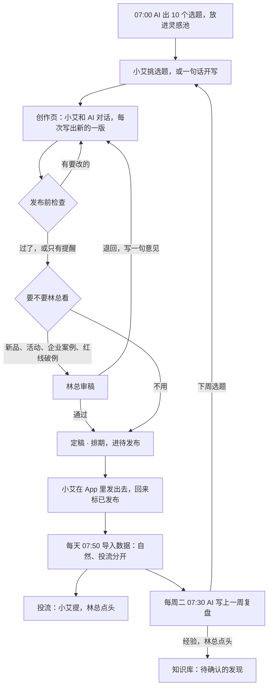
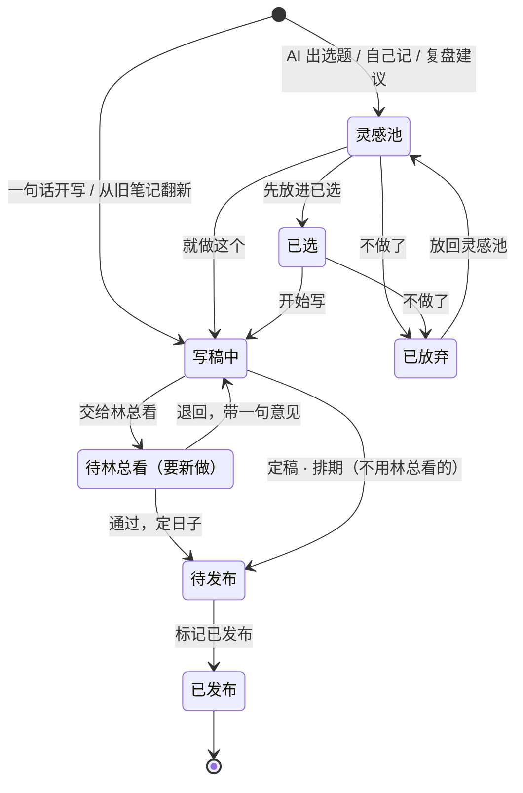

# 模块需求文档：小红书内容中心

> 一句话：给林总和小艾用，把一篇小红书从选题、写稿、检查、发布到看数、复盘放进同一个地方；做完的样子是林总早上打开就知道今天发哪篇、能不能发，每周看一份复盘，好经验点一下就进知识库。
> 状态：课上范例（按示例老板 ABC茶社 写，人和事全部虚构；真实老板用时改成“草稿”，确认后写“已确认（日期）”）｜版本：v1｜对焦记录：示例，根据 `99-原始材料/采访记录/2026-10-20-建库采访.md` 第 9、10、11 题和 10/25 补访四整理
> 示例数据，人和事都是虚构的；名字、数字只取自示例老板 ABC茶社 的知识库和模板的示例数据。

## 1. 为什么要做

结论：小红书是 ABC茶社 让人认识、也带来过企业客户的入口，但现在全压在小艾一个人身上，林总只能每周一听她讲一遍。

- **现在怎么做**：小艾一个人写、拍、发，近 60 天发了 41 篇（图文 36、视频 5），常在 12:10、18:30、20:00 发。林总每周一跟她过一遍上周的。投流“小艾提，我点头才投，一篇一般就几百块”，近 60 天投了 8 篇、共 3204 元。数据每天早上小艾从专业号后台导出。
- **卡在哪**：
  1. 人手紧：选题、写稿、配图、看数都是小艾一个人。林总：“她一个人顶不住。”
  2. 红线多，发出去收不回：功效词、极限词、企业客户名字、11/5 上线前的新品名字和日子。
  3. 数看不清：投流和自然混在一起；“收藏多”“看的人不多”只是印象，好的写法没人记下来。
- **做完以后**：
  - 林总早上打开“小红书 · 今天”，10 秒内知道今天发哪篇、几点发、检查过没过。
  - 小艾说一句“降温了，写一篇上班族的”，3 分钟内右边出现能发的稿子和手机上的样子，红线一处不漏。
  - 每周看一份复盘，自然和投流分开说；林总点头的经验进知识库，下次 AI 写稿就照着写。

## 2. 谁在什么时候用

| 场景 | 谁 | 什么时候 | 想知道或想做什么 | 现在要花多久 |
|---|---|---|---|---|
| 早上看今天 | 林总 | 每天 8 点前，和经营早报一起看 | 今天发哪篇、几点、能不能发 | 要问小艾（时长待确认） |
| 挑选题 | 小艾 | 每天上午 | 早上 AI 出的 10 个选题里挑 1—2 个，或记下自己想的 | 待确认 |
| 写稿 | 小艾，林总偶尔 | 发布前 1—3 天 | 和 AI 对话出稿，改标题、开头、封面，看手机上的样子 | 待确认 |
| 审稿 | 林总 | 新品预热、送样或活动、要讲企业案例、红线要破例时 | 看手机预览和检查，通过或退回 | 待确认 |
| 发布 | 小艾 | 12:10 / 18:30 / 20:00 | 在小红书 App 里发出去，回来标“已发布” | — |
| 看数据 | 小艾、林总 | 发布后第 1、3、7 天 | 这篇怎样；哪类内容收藏高；自然、投流分开 | 每天导表、登后台看 |
| 投流 | 小艾提，林总定 | 发布后 1—3 天 | 哪篇值得投、投多少 | 当面说（待确认） |
| 每周复盘 | 林总 + 小艾 | 每周二早上出复盘；周一周会怎么用待确认 | 上周哪篇好、要改什么、下周写什么 | 林总看一遍约 10 分钟 |

## 3. 业务流程

结论：一篇笔记从选题到复盘是同一条记录。AI 出主意、写草稿、算数；定稿、发布、投流、存经验都由人拍板。

主流程：
1. 每天 07:00，AI 按账号定位、作品索引（避开最近 30 天发过的）和客户常问的问题出 10 个选题，写进灵感池；每个带来源、为什么现在写、归哪个内容支柱。（工作台自动）
2. 小艾在“今天”页挑：“就做这个”直接进创作页；“先放进已选”留着；不合适的点“不做了”。也可以从旧笔记、一款茶、一篇对标笔记开始，或直接说一句话。（小艾）
3. 小艾在创作页说要求，AI 读知识库写一版：3 个备选标题、封面大字、3—6 张图片页、正文、话题。右边稿件和手机预览一起刷新。（小艾 + AI）
4. 发布前检查边改边查，有“要改”的照建议改，或让 AI 改。（工作台自动 + 小艾）
5. 需要林总看的，小艾点“交给林总看”；林总在手机上看预览和检查，“通过”或“退回”并写一句意见。（林总）
6. 定稿：选发布日和时间，进“待发布”，排进日历。（小艾）
7. 到点小艾在小红书 App 里自己发，回来点“标记已发布”。（小艾）
8. 第二天 07:50 起，数据随小艾导出的“笔记数据”表进来，自然、投流各一行；单篇看第 1、3、7 天。（小艾导出 + 工作台导入）
9. 想投流：小艾在这篇里写投多少、为什么，林总点头才投，花了多少记下来。（小艾 + 林总）
10. 每周二 07:30，AI 写上一周（周二到下周一）的复盘；下周选题一键放进灵感池，经验林总点“存进知识库”。（AI + 林总）

例外和分支：
- AI 不可用、超时或被停掉：如实写“这一轮没答完”，可以重试，已有的稿子不丢。
- AI 回复的稿件格式坏了：说明照样显示，标“稿件没解析出来”，不硬猜。
- 选题碰上经营那边没处理完的事（例：玻璃公道杯正在退款）：选题和单篇里提示“先放一放”，能点去经营看。
- 排期碰上门店停业（11/3 起约 10 天）：提醒品茶会、门店活动这几天别排。
- 新品上线日（11/5）当天起，新品名字和日子不再拦。
- 数据没导进来（例：10/26 平台改了导出表的列名）：页面写“数据截至 10/25”，没有的数写“—”，不当 0。

## 4. 关键对象和状态

### 业务里有哪些“东西”

| 东西 | 是什么 | 要记哪些信息 | 从哪来 |
|---|---|---|---|
| 一篇内容 | 从选题到发布是同一条 | 标题、切入角度、图文还是视频、内容支柱、来源、为什么做、提醒、状态、排期日和时间、发布时间、链接、谁记的 | AI 出的选题、小艾或林总自己记、复盘建议、旧笔记翻新 |
| 稿件版本 | 每写出或改一次存一版，只增不改 | 标题和备选、封面大字和样式、图片页、正文、话题、AI 自查、谁写的、怎么来的 | AI 写稿、手动修改、采用候选、恢复旧版、导入原文 |
| 创作对话 | 创作页里人和 AI 的来回 | 谁说的、说了什么、参考了哪些文件、实际读了哪些文件、写成第几版、用了多久、现场还是示例 | 创作页 |
| 审稿意见（新） | 林总看过的结论 | 通过或退回、一句意见、看的是第几版、什么时候 | 林总 |
| 笔记数据 | 发出去以后的表现 | 曝光、阅读、点赞、收藏、评论、分享、涨粉，自然和投流分开；数据截至哪天；发布后每天的累计 | 小艾每天导出的“笔记数据”表 |
| 投流记录（新） | 哪篇投了多少 | 谁提的、预算、理由、林总意见、实际花费 | 小艾提，林总定 |
| 每周复盘 | 一周一份 | 指标、总结、做得好的、要改的、下周选题、经验（每条带依据、适用范围和样本数） | AI 写，林总看 |
| 内容支柱 | 账号写的四块 | 办公室 3 分钟泡茶、一周喝茶搭配、茶具小知识、新品试喝 | 知识库《小红书账号定位》 |
| 评论、对标笔记 | 选题的来源 | 赞最多的几条评论；同行笔记的结构和“我们怎么借” | 小艾整理（录入要新做） |

### 状态节点

| 状态 | 什么意思 | 怎么进来（谁、做了什么） | 下一步能去哪 | 进来时自动发生什么 |
|---|---|---|---|---|
| 灵感池 | AI 和团队攒下的想法 | AI 早上出选题；小艾或林总记一个；复盘建议放进来；从“已放弃”放回 | 已选、写稿中、已放弃 | 记下谁出的、哪一次出的、几点 |
| 已选 | 决定要做，还没动笔 | 小艾点“先放进已选” | 写稿中、已放弃 | 可以先排个日子 |
| 写稿中 | 在创作页和 AI 一起写 | 点“开始写”；在创作页发出第一句；第一版稿子存出来；林总退回 | 待林总看、待发布 | 开始边改边查；标题跟着最新稿件走 |
| 待林总看（新） | 交给林总，等他点头 | 小艾点“交给林总看” | 待发布（通过）、写稿中（退回） | 林总那边出现一条提醒 |
| 待发布 | 定稿了，等那天发 | 定稿 · 排期 | 已发布 | 排进日历；那天“今天”页置顶 |
| 已发布 | 发出去了，跟数据 | 小艾“标记已发布” | 不能回退 | 记发布时间；导入数据时对上这篇 |
| 已放弃 | 不做了，留个记录 | 点“不做了” | 灵感池 | 看板上不显示，列表里找得到 |

### 改状态的规矩
- 新建的只能进灵感池、已选或写稿中；写好、定了日子再往后推。
- 进“待发布”：要有一版稿子、有发布日，日子不能是过去。
- 进“已发布”：时间默认现在，不能晚于现在（没发出去不能标）；链接可以不填。
- 已发布的不能退回、不能改稿、不能改排期；要再写一篇就“从这篇翻新”，另开一篇。
- 稿件只增不改；恢复旧版也是另存一版，谁、什么时候、怎么来的都留着。
- AI 在写时这一篇锁住，同一篇同时只跑一轮。
- （新）新品试喝和预热、送样或活动、要讲企业案例的，没经林总通过不能进“待发布”。
- 每次换状态记一条改动：谁、什么时候、从哪到哪。

## 5. 页面和交互

放在导航哪里：分区“内容” → 菜单“小红书”，下面 5 个子页面：今天、内容、创作、数据、复盘。手机底栏“内容”一格进来。**只有创作页有对话窗口**，其他页面只有入口。

| 页面 | 第一屏看到什么 | 能做什么 | 详情怎么打开 |
|---|---|---|---|
| 今天 | “今天发这篇”大卡：手机缩略图、状态、检查结论；一句话入口和四个起点；本周 7 天排期；今日选题（按哪一次出的分组，写清谁、几点、用了多久）；数据提醒 2—3 条 | 继续写、看预览、标记已发布；就做这个、先放进已选；再出 3 / 5 / 10 个选题（可写个方向） | 点任一篇开右侧抽屉 |
| 内容 | 看板五列：灵感池 → 已选 → 写稿中 → 待发布 → 已发布 | 拖动换阶段（拖到待发布先定日子，拖到已发布先确认时间）；切日历（月 / 周，拖动改日子，停业日斜线、新品上线日角标）；切列表（筛状态、支柱，搜标题） | 右侧抽屉 |
| 创作 | 开始页：一句话、四个起点、在写的几篇；进一篇后左边约 40% 是对话，右边约 60% 是稿件 / 预览 / 封面 / 版本四个页签，右上角“已保存 · v3” | 对话、用候选、直接改稿、换封面模板和底图、恢复旧版、复制整篇、定稿 · 排期、交给林总看（新） | 一篇一个地址 |
| 数据 | 自然、投流两张汇总卡（和上一段时间比）；内容支柱 × 一篇收藏的中位数；按周的篇均赞藏和发了几篇；笔记表格 | 筛时间（7 / 30 / 60 天）、流量（全部 / 自然 / 投流）、形式、支柱；按阅读、收藏、收藏率、时间排 | 点标题开右侧抽屉 |
| 复盘 | 按周的列表（本周 / 未复盘 / 已复盘，几条经验待定）；一周的指标（比上周）、总结、做得好的、要改的、经验、下周选题、这周发的笔记 | 生成、重新生成（旧的一份留着）；改经验措辞、标“不要”、存进知识库（先看要追加的那一节）；选题放进灵感池 | 点笔记开右侧抽屉 |
| 单篇抽屉 | 左边手机预览（发现页 / 笔记页）；右边没发的看发布前检查，发了的看第 1、3、7 天和赞最多的几条评论 | 按状态给按钮：开始写、排期、定稿、标记已发布、从这篇翻新、不做了；审稿（新）、提投流（新） | 地址里记着这一篇，刷新、转发还在 |

关键交互过程一：一句话写一篇
1. 小艾在“今天”页输入“降温了，写一篇上班族的”，回车。
2. 工作台新建一篇（写稿中，起点记成“一句话”），把这句话当第一条消息发给 AI，跳到创作页。
3. 左边起点卡写着为什么做、AI 手上有哪些资料（品牌与口吻、账号定位、写法卡、作品索引和规律、商品清单），每份都能点开看原文；对话里滚动显示“正在读 品牌与口吻、场景开头……”。
4. AI 回 2—5 句说明（按哪张写法卡、改了哪些说法、拿不准的问一句）和“参考了”哪些文件；工作台把稿件存成 v1，右边稿件、手机预览、发布前检查一起刷新。
5. 小艾说“标题再给 3 个”，对话里出 3 个候选，点“用这个”存成 v2。
6. 点“定稿 · 排期”，选 10/30 12:10；有“要改”的项会先列出来，进“待发布”，日历上出现。

关键交互过程二：林总审稿（新）
1. 小艾在创作台点“交给林总看”，可以留一句话（例：“结尾送样的数量你定”）。
2. 林总在今日页或手机上看到“1 篇等你看”，点开单篇抽屉：手机预览、发布前检查、AI 自查。
3. 林总点“通过”，或点“退回”写一句意见（例：“寄小样的事我还没定，先别写数量”）。
4. 退回的回到“写稿中”，意见作为一条“林总”的消息出现在对话里，下一轮自动带给 AI。

今日页放什么：“小红书今天发什么”——今天要发的篇（几点、状态、检查结论）、今天的选题前 3 个、粉丝数和数据截至哪天；（新）等林总看的篇数、等林总点头的投流。

## 6. AI 帮什么

| AI 做什么 | 什么时候 | 读哪些资料 | 结果写到哪 | 要老板确认吗 |
|---|---|---|---|---|
| 出选题 | 每天 07:00 定时；页面上点“再出几个” | 账号定位、作品索引、客户原话与顾虑、品牌与口吻；工作台算好的账号数据 | 灵感池，每个带来源、理由、支柱、角度 | 不用，挑不挑由人定 |
| 写一篇、改稿 | 创作页每说一句 | 每次读品牌与口吻和账号定位，再挑 1—3 张写法卡；写到茶和价格才查商品清单；工作台附上选题、当前稿件、最近 8 条对话、账号数据、3 篇相似的自家笔记 | 新的一版稿件 | 定稿、发布由人做 |
| 给候选 | “再给 3 个标题 / 封面大字 / 开头 / 角度” | 同上 | 对话里 3 个候选，点“用这个”才写进稿子 | 人点选 |
| 写稿时自查 | 每次写稿 | 不能说的话、用到的写法卡里“别这样做” | 稿件里的“AI 自查”；之后有人改过就标“以上面的检查为准” | — |
| 写复盘 | 每周二 07:30；页面上“生成复盘” | 账号定位、规律、写法卡；工作台算好的本周和上周数据 | 复盘页 | 经验进知识库要林总点头 |
| 发布前检查 | — | 不用 AI，本地规则，边改边查 | — | — |

AI 怎么接：
- 用老板电脑上的 AI，工作目录是知识库根目录；**只能看，不能改，不能联网**，不批准任何命令。
- 按模块自带的写作规则读资料、写稿。知识库里没有的价格、规格写“【待补：××】”，不编。
- 回复格式固定：2—5 句说明 + 一行“参考了：……” + 最多一个结构化的块（稿件 / 候选 / 选题 / 复盘）。工作台解析后写库，**AI 不直接写数据库**。
- 写超过 90 秒提示“比平时慢，还在写”，180 秒停掉；人可以随时停、可以重试。演示用的示例对话标“示例”，不冒充现场生成。

## 7. 提醒

| 什么时候 | 提醒什么 | 点开去哪 |
|---|---|---|
| 每天早上（今天页、今日页） | 今天发哪篇、几点、检查结论 | 单篇抽屉 |
| 每天早上（今天页，按规则算，最多 3 条） | 最近两周哪个支柱自然阅读最高；哪篇大半阅读来自投流、自然收藏率却低于账号中位数；数据停在哪天 | 围绕它出选题 / 单篇抽屉 / 数据源 |
| 导入失败或没按时更新（系统提醒，每个来源每天一次） | 小红书笔记数据没导进来 | 数据源 |
| 小艾交给林总看时（新） | 某篇等你看 | 单篇抽屉 |
| 林总退回时（新） | 某篇被退回，附林总意见 | 这篇的创作台 |
| 小艾提投流时（新） | 某篇想投多少、为什么 | 单篇抽屉 |
| 每周复盘写好时（新） | 上周复盘好了，几条经验等你点头 | 复盘页 |
| 晚上 10 点到早上 8 点 | 不弹，沿用工作台的免打扰，早上 8 点再弹 | — |

## 8. 数据从哪来、存在哪

| 数据 | 从哪来 | 多久更新 | 谁写进来 | 和知识库的关系 |
|---|---|---|---|---|
| 笔记数据（曝光、阅读、点赞、收藏、评论、分享、涨粉）和粉丝每天的变化 | 专业号后台导出的“笔记数据”“粉丝数据”两张表，放进工作台的导入文件夹 | 每天：小艾 07:45 前导出，07:50 自动导入 | 小艾导出，工作台导入 | 不进知识库；作品索引的数以它为准 |
| 自然还是投流 | 表里“流量来源”带推广、投流、薯条、聚光的算投流，其余算自然 | 同上 | 自动 | — |
| 投流花费 | 导出表里没有（新：小艾记；以后导聚光报表） | 每次投流 | 小艾 | — |
| 选题 | AI | 每天 07:00，或页面上现出 | AI 经工作台命令写回 | 不写进知识库 |
| 稿件、版本、对话 | 创作页 | 随时 | 小艾、林总、AI | 不写进知识库 |
| 不能说的话 | 知识库《品牌与口吻》里“不能说的话”那张表 | 文件一改，检查马上按新的查 | 林总确认，知识库整理时写 | 只读 |
| 企业客户名字 | 工作台客户表里企业茶礼、渠道合作两类 | 实时 | 客户模块 | 只读 |
| 新品名字和上线日 | 知识库零售商品清单里“待上线 / 上线前保密”的行 | 文件一改就重读 | — | 只读 |
| 门店停业、售后异常 | 项目里程碑、经营异常 | 实时 | 别的模块 | 只读 |
| 复盘经验 | 复盘页 | 每周 | 林总点“存进知识库” | 追加到 `90-持续生长/待确认的发现.md`，再由整理知识库时写进规律或写法卡 |

## 9. 规矩和边界

- **一定要老板确认的**：
  - 投流：小艾提，林总点头才投。
  - 新品试喝和预热、送样或活动、要讲企业案例的笔记：发之前林总看。
  - 检查里“不能说的话”“客户名字”“新品名字和上线日”有要改的，还想照样发：林总点头；字数、张数这类规格提醒小艾自己定。
  - 经验存进知识库：林总先看要追加的那一节，再点“存进知识库”。
- **不能做的**：
  - 不登录小红书、不替发布、不用林总或店的名义发（第 11 题）。
  - 不自动投流，不改推广出价。
  - 不改知识库原文；只在《待确认的发现》末尾追加，写之前先备份原文件。
  - 不批量抓取别人的笔记；对标笔记手动收藏，只借结构。
  - 不编数：没有的数写“—”，不当 0；样本少就写“只供参考”，不把笔记数据直接归因成成交。
- **隐私**：
  - 企业客户名字只用来拦，不进稿件；数据页、复盘只给内部看。
  - 新品上线前，名字和日子不出现在标题、封面、图片、正文、话题任何一处。
  - 稿件里不出现文件路径、“知识库”“AI”“工作台”这类内部字眼。
  - 稿件是要发出去的：知识库里的客户名字、电话、进货价这些真实资料，一律不写进稿件（发布前检查会拦客户名字）。

## 10. 第一版做什么

- **第一版一定要有**：五个子页和单篇抽屉；六个状态加林总审稿；创作对话和版本；手机预览和模板画的封面；发布前检查；每天导入数据、自然和投流分开；新发的笔记能对上数据；每周复盘和经验进知识库；投流申请和花费手填。
- **以后再说**：投流花费从聚光报表导入；评论、对标笔记的录入入口；视频脚本和分镜；招了兼职以后按人分选题；AI 生图做封面；林总亲手改过的稿整理成发现（按知识库的“改稿后记下来”）。
- **不做**：自动发布、登录小红书、抓取别人笔记、积分、平台接口。
- **待确认**：复盘是每周二出（和知识库每周复盘一致），林总习惯周一跟小艾过上周——周一周会看哪一份，还没问。

## 11. 怎么算好（验收）

- [ ] 打开“小红书 · 今天”，10 秒内看到今天发哪篇、几点发、检查结论。
- [ ] 说一句“写一篇降温喝白茶的”，3 分钟内右边有稿件和手机预览，说明里写了按哪张写法卡、参考了哪些文件。
- [ ] 稿子里写进“养胃”、一家企业客户的名字、新品名字或“11/5”，检查当场标“要改”并给替换说法；把发布日改到 11/5，新品名字不再拦。
- [ ] 小艾交给林总看，林总退回并写一句意见；小艾在对话里看到这句，下一版 AI 按它改了。
- [ ] 标记已发布，第二天导入数据后，这篇有自然、投流两行，第 1、3、7 天能看。
- [ ] 数据页切到“自然”，内容支柱按一篇收藏的中位数排，不被两篇爆款拉高。
- [ ] 生成上周复盘，点一条经验“存进知识库”，《待确认的发现》末尾多一张发现卡，原文件有备份。
- [ ] 关掉 AI 或断网，创作页如实说“没答完”，能重试，稿子不丢。
- [ ] 手机宽度能看；`npm run build`、`npm run doctor` 通过。

## 12. 给开发的提示

- **参考实现**：模板的 `content` 模块就是这份需求的大部分。服务端 `template/server/modules/content/`（`pieces` 状态和版本、`checks` + `shared/xhs-check.ts` 发布前检查、`studio` + `codex` + `parse` 创作对话、`topics` 选题、`stats` 数据和提醒、`reviews` 复盘、`center` 今天页和起点），网页 `template/src/features/content/`，表在 `004_content.sql`、`013_content_center.sql`、`013_content_center_02_来源与评论.sql`，示例数据在 `server/seed/content*.ts`。

  | 需求 | 参考实现 |
  |---|---|
  | 五个子页、单篇抽屉、看板 / 日历 / 列表、手机预览、模板画封面 | 照用 |
  | 六个状态和改状态的规矩（`STATUSES`、`updatePiece`）；版本只增不改 | 照用 |
  | 创作对话：`codex exec` 只读沙箱、`approval_policy="never"`、关联网、工作目录 = 知识库根；带最近 8 条对话；回复解析 `<draft>` / `<options field=…>` / `<topics>` / `<review>`，JSON 坏了标“没解析出来”；180 秒超时，90 秒提示慢 | 照用 |
  | 发布前检查 10 项：标题、正文、话题、封面大字、图片张数、不能说的话、客户名字、新品名字和上线日、AI 腔、内部用词 | 照用；词表现读，文件改了自动重读 |
  | 每周复盘（周二到下周一）、重新生成留旧的一份、经验预览后追加进 `90-持续生长/待确认的发现.md`（先备份）、选题放进灵感池 | 照用（发现卡的“采纳后写到”一行 2026-10-13 已补上） |
  | 林总审稿（交给林总看 / 通过 / 退回带意见）；红线项照样定稿要林总点头 | **还没有，要新做**。现在只靠备注“发之前等林总看一眼”，谁都能点“照样定稿”“照样发”；旧表 `xhs_drafts` 的“待林总看”新页面不用 |
  | 分清是小艾还是林总在操作 | **还没有，要新做**。网页上的消息、版本、改动都记成 `identity().owner`（老板） |
  | 投流申请和花费 | **还没有，要新做**。导入表里没有花费，`server/modules/data/notes.ts` 沿用原来记的数 |
  | 新发的笔记对上数据 | **还没有，要新做**。导入只更新 `xhs_notes` 里已有的笔记，新标题报“找不到这篇笔记”；“标记已发布”也没写 `xhs_pieces.note_id` |
  | 每周二定时复盘写回工作台 | **还没有，要新做**。示例里的“定时任务写的”是预置数据，只能在网页现场生成 |
  | 评论、对标笔记的录入 | 只有示例数据，没有入口（第一版不做） |
  | 内容相关的系统提醒（审稿、退回、投流、复盘写好） | **还没有，要新做**。提醒模块只管待办、日程、跟进、异常、数据源、汇总 |
  | 数据页“按周”和复盘的周 | 口径不一：数据页按周一到周日（`isoWeek`），复盘按周二到下周一，待确认统一 |

- **模块开关 id**：`content`。打开 `content` 时自动带上 `data`（数据源与导入，见 `shared/modules.ts` 的 `needs`），笔记数据靠它进来。命令：`node server/cli.ts settings-set --modules today,content,…`。导航在 `src/app/nav.ts` 的 `content` 项（分区“内容”，5 个 `children`）。
- **建议的表和字段**：沿用 `xhs_pieces`、`xhs_versions`、`xhs_messages`、`xhs_note_stats`、`xhs_note_daily`、`xhs_reviews`、`xhs_jobs`、`xhs_comments`、`xhs_benchmarks`。新加一个迁移（例 `017_content_审稿与投流.sql`，不改旧文件）：
  - 审稿用单独的字段，不改状态列表（SQLite 改不了 CHECK，免得重建表）：`xhs_pieces.review`（无 / 待林总看 / 通过 / 退回）、`review_note`、`review_version`、`reviewed_by`、`reviewed_at`；
  - 投流新表 `xhs_boosts`：`piece_id`、`budget`、`reason`、`asked_by`、`asked_at`、`decision`、`decided_by`、`decided_at`、`spend`；
  - 导入时按标题和发布时间对上“已发布”的篇，没有笔记就新建一条 `xhs_notes` 并写 `note_id`。
- **要加的命令行命令**：已有 `xhs`（看今天）、`xhs-topics-add --file`（定时选题写回）。要加 `xhs-review-add --week 2026-10-20 --file`（定时复盘写回）、`xhs-pending`（等林总看的篇和投流）、`xhs-boost-add`（记投流花费）。网页和命令走同一套规则，不直接写 SQL。
- **换成抖音、公众号等别的平台**：

  | 照用 | 要改 |
  |---|---|
  | 一篇从选题到复盘是同一条、六个状态和审稿 | 稿件字段：抖音是口播脚本、分镜、时长、封面；公众号是标题、摘要、正文排版、2.35:1 封面，没有图片页和话题 |
  | 版本只增不改、创作对话的接法和回复解析 | 规格检查：小红书的标题 20 字、正文 1000 字、话题 5—8 个、图片 3—9 张要换成那个平台的 |
  | 红线检查（不能说的话、客户名字、新品名字和上线日、AI 腔、内部用词） | 手机预览：发现页 / 图文笔记页换成竖屏视频页或公众号文章页 |
  | 自然和投流分开、比较用中位数、数据截至哪天 | 数据字段和对照：抖音加完播率、平均播放时长；公众号是阅读、在看、分享，没有投流的就去掉投流卡；“流量来源”的判断词换成 DOU+、巨量这类 |
  | 每周复盘和经验进知识库 | 写作规则 `.agents/skills/xhs-creator/` 换成那个平台的，写法卡也要另采 |

  另外，参考实现里写死了 ABC茶社 的东西，换老板、换平台都要改成从知识库的建库档案读：提示词里的 `11-内容与作品/…` 路径和“四个内容支柱”、`checks.ts` 的商品清单和新品项目文件路径、客户名后缀表、`related.ts` 的公道杯退款规则、茶具底图和封面模板。
- **遵守**：工作台程序文件夹里的 `规范/README.md`；详情用右侧抽屉，新建用弹窗，看板卡片不放改状态的下拉。

## 附：对焦时的关键原话

均出自 `99-原始材料/采访记录/2026-10-20-建库采访.md`（示例数据）。

- “小艾一个人做，图文为主，偶尔拍个短视频，差不多天天发，这两个月三十多篇。我每周一跟她过一遍上周的。她一个人顶不住，我想招个兼职帮她。”（第 9 题）
- “别说功效，平台会限流，也不合规。‘最’‘第一’这种词也别用。别家的茶不说坏话。企业客户的名字不能出现。”（第 9 题）
- “小艾提，我点头才投，一篇一般就几百块。”（第 9 题追问：投流怎么定）
- “早上最想看三样：……三是小红书今天发什么。”（第 10 题）
- “也别用我的名义、店的名义发小红书、朋友圈。”（第 11 题）
- “新品上线前名字别说，日子也别说。名字说早了，客户来搜，搜不到、买不到，白白跑了。”（10/25 补访四“小红书内容”）
